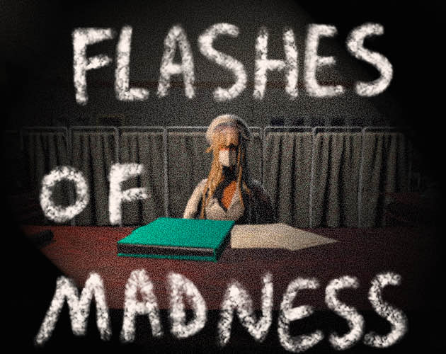

# Musse Hidru — Game Designer & Gameplay Programmer

My personal portfolio website, hosted on GitHub Pages.

**Live site:** [electromos26.github.io](https://electromos26.github.io)

## About

I'm a game developer with over three years of experience building games in Unity and C#. I focus on gameplay and systems design, with an eye for UX, and I love refining mechanics until they feel right in the player's hands.

## Featured games

| Game | Engine | Play |
|---|---|---|
| Flashes of Madness | Unity | [itch.io](https://teamkrakenhunters.itch.io/flashes-of-madness) |
| Bubble Buddy | Unity (game jam) | [itch.io](https://notperz.itch.io/bubble-buddy) |
| Wavy Davy | Unity | [itch.io](https://teamkrakenhunters.itch.io/wavydavy) |

More games on [my itch.io page](https://electromos26.itch.io).

## What's on the site

- About me and the genres I've worked on
- Demo reel
- Projects with links to play them
- Work experience
- Skills, tools and studies
- [Downloadable CV](Assets/Musse_Hidru_CV.pdf)

## Contact

- [LinkedIn](https://www.linkedin.com/in/musse-hidru)
- [GitHub](https://github.com/Electromos26)
- [itch.io](https://electromos26.itch.io)
